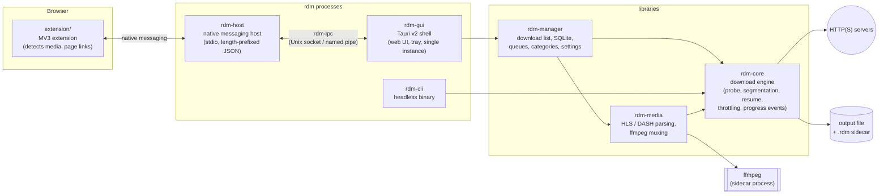

# rdm — Rust Download Manager

A cross-platform (macOS, Windows, Linux) download manager written in Rust,
inspired by Internet Download Manager and
[ab-download-manager](https://github.com/amir1376/ab-download-manager).

> **Status:** Phases 1–6 done: the download engine (`rdm-core`), the
> headless `rdm` CLI, the desktop app (`rdm-gui`, backed by `rdm-manager`),
> browser integration (extension, `rdm-host`, `rdm-ipc`), streaming media
> (`rdm-media`: HLS/DASH) and IDM-style extras (scheduler, import/export,
> checksums, antivirus hook, duplicate detection, drag-and-drop). Packaging
> and the first release come next.
> See [Roadmap](#roadmap).

## Architecture



The dependency rule: **`rdm-core` depends on nothing above it.** It has no
GUI, extension or ffmpeg dependencies, and it can be used on its own as a
library. CI enforces this with [`scripts/check-deps.sh`](scripts/check-deps.sh).

| Path | Kind | Responsibility |
|---|---|---|
| `crates/rdm-core` | lib | Probing, dynamic segmentation, positioned writes to one sparse file, resume metadata, retry/backoff, throttling, progress events |
| `crates/rdm-manager` | lib | The download list: SQLite persistence, queues with concurrency limits, categories with folders, settings, change events. No GUI dependency |
| `crates/rdm-media` | lib | HLS/DASH parsing, concurrent resumable segment download, AES-128 HLS, joining or ffmpeg merging, opt-in ffmpeg install. Refuses DRM |
| `crates/rdm-cli` | bin `rdm` | Headless front end, used to test the engine without a GUI |
| `crates/rdm-ipc` | lib | Messages, length-prefixed JSON framing, and a private local socket (Unix) or named pipe (Windows) between `rdm-host` and the app |
| `crates/rdm-host` | bin `rdm-host` + lib | Native messaging host, launching the app on demand, and the per-browser manifest installer (Chrome, Chromium, Edge, Brave, Firefox; registry on Windows) |
| `crates/rdm-gui` | bin `rdm-gui` | Tauri v2 desktop app: commands over `rdm-manager`, plain HTML/CSS/JS UI in `ui/` (no build step) |
| `extension/` | MV3 | Browser extension (plain JS): media detection, video Download button, download capture, download-all-links. See [extension/README.md](extension/README.md) |
| `tests/` | crate `rdm-tests` | axum mock server and integration tests |

## Building

Prerequisites: a stable Rust toolchain (installed through
[rustup](https://rustup.rs); `rust-toolchain.toml` selects stable with
rustfmt and clippy). TLS uses rustls, so OpenSSL is never required.

```bash
cargo build --workspace
```

```bash
cargo test --workspace
```

These are the same checks CI runs on all three OSes:

```bash
cargo fmt --all --check
```

```bash
cargo clippy --workspace --all-targets --all-features --locked -- -D warnings
```

```bash
./scripts/check-deps.sh
```

## The desktop app

- **Download list:** speed, ETA, and a progress bar that shows each
  connection's segment. Selecting a download opens a details pane.
- **Add URL:** the server is checked first, which fills in the file name,
  size, whether it can resume, the category and the folder. Downloads can
  start now, go into a queue, or be added stopped. Referer, User-Agent and
  cookies can be set per download.
- **Queues:** each runs N downloads at a time and starts the next one when a
  download finishes. Queues start stopped when the app opens, so nothing
  downloads unexpectedly.
- **Categories:** Video, Music, Documents, Archives, Programs and Other, each
  with its own folder and editable extension list.
- **Settings:** connections, minimum piece size, total speed limit, proxy,
  default folder, close to tray.
- **Persistence:** everything is kept in SQLite in the app data folder.
  Downloads that were running when the app quit come back stopped and resume
  from their `.rdm` file. Cookies are kept in memory only and never written
  to disk.
- **Tray and window:** a tray icon, close to tray, and a single running
  instance (launching again focuses the open window).
- **Browser integration:** Settings → Browser registers `rdm-host` with
  the browsers on this machine. Requests from the extension open the Add
  dialog prefilled (single item) or go into the queue (download all links).
  See [extension/README.md](extension/README.md).
- **Clipboard monitoring:** copying an http(s) link to a known file type
  offers to download it, so rdm still works without the extension. It can
  be turned off in Settings.

## Scheduling, verification and other extras

- **Scheduler:** each queue can start and stop at set local times on chosen
  weekdays, daily or once. A start missed by more than two hours (computer
  asleep, rdm closed) is skipped rather than firing late. When a queue
  finishes, rdm can do nothing, quit, or shut the computer down after a
  60-second countdown you can cancel.
- **Import/export** (the ⋯ menu): an rdm JSON list or a plain URL list, for
  everything or just the selection. Import takes either, plus any text with
  one URL per line. Cookies are never exported.
- **Checksums:**
  - Enter an expected checksum (`sha-256:…`, `sha-1:…`, `md5:…`, `sha-512:…`
    or bare hex) when adding a download.
  - A checksum the server publishes in `Repr-Digest`, `Digest` or a full
    response's `Content-MD5` is used automatically.
  - A mismatch marks the download failed and keeps the file.
  - "SHA-256" in the details pane hashes any finished file.
- **Antivirus hook** (Settings → General): a command run on every finished
  file, with `{file}` replaced by its path. It runs directly, never through
  a shell, with a 10-minute timeout. Presets are included for Microsoft
  Defender and ClamAV.
- **Duplicate detection:** adding a URL that is already in the list, or a
  file identical by name and size to a finished one, asks first.
- **Drag-and-drop:** drop a link onto the window to open the Add dialog,
  several links to queue them, or a `.txt`/`.json` list to import it.

## Streaming media (HLS / DASH)

Paste a `.m3u8` or `.mpd` URL into Add, or pick a stream from the extension.
rdm reads the playlist and offers each quality, the audio tracks and an
output format (MP4, MKV, M4A, MP3).

- **What's supported:** HLS master and media playlists (MPEG-TS or fMP4,
  `EXT-X-BYTERANGE`, `EXT-X-MAP`, separate audio renditions), and static
  single-period DASH (`SegmentTemplate` with `$Number$` or `$Time$`, with or
  without `SegmentTimeline`, `SegmentList`, `SegmentBase`).
- **Download:** segments are fetched in parallel through the same network
  stack as everything else (cookies, Referer, speed limits, per-host caps)
  into a `<file>.rdm-parts` folder. Stopping keeps them, and starting again
  resumes.
- **Encryption:** standard AES-128 HLS is decrypted. DRM (SAMPLE-AES,
  FairPlay, Widevine, PlayReady, CENC) is refused before anything
  downloads, reported as protected content. Live streams are not supported
  yet.
- **ffmpeg** is only needed to merge separate video and audio, to turn
  MPEG-TS into MP4, or to extract audio. Single-track streams are joined
  directly. Without ffmpeg, a TS stream is saved as `.ts`.
- **Getting ffmpeg:** Settings → Media can download a static build into
  rdm's own folder after you agree, and checks its published SHA-256 first:
  - macOS: Martin Riedl's builds (GPLv3).
  - Windows: Gyan's builds (GPLv3).
  - Linux: use your package manager. The only zip-with-checksum Linux builds
    are compiled `--enable-nonfree`, so rdm doesn't offer them.

## Using the CLI

```bash
cargo install --path crates/rdm-cli
```

```bash
rdm get https://example.com/big.iso -c 8 --limit 5M
```

- `-o PATH` saves to a file, or into a directory under the server's file
  name. The default is the current directory.
- Ctrl-C stops and keeps progress. Running the same command again (or
  `rdm resume <file>`) continues from where it stopped, after checking that
  the server's file hasn't changed (ETag / Last-Modified / size).
- `rdm probe URL` shows the size, whether the server supports resuming, the
  file name and the validators, without downloading anything.
- The cookie, Referer, User-Agent, Basic auth and proxy options are listed in
  `rdm get --help`.

### Reproducing the speed benchmark

`mock-server` serves deterministic content and can cap each connection's
speed. That cap is the situation where multiple connections help:

```bash
cargo run --release -p rdm-tests --bin mock-server -- --size 1G --rate 25M
```

```bash
cargo run --release -p rdm-cli -- get http://127.0.0.1:8080/file.bin -o one.bin -c 1 --no-proxy
```

```bash
cargo run --release -p rdm-cli -- get http://127.0.0.1:8080/file.bin -o eight.bin -c 8 --no-proxy
```

```bash
cargo run --release -p rdm-tests --bin mock-server -- --verify eight.bin --size 1G
```

On an M-series Mac this took 41.4 s with one connection and 5.2 s with
eight. A `kill -9` partway through, followed by a re-run, produced a file
with the same SHA-256.

## Tests

```bash
cargo test --workspace
```

The integration tests in [`tests/`](tests) run the engine against an axum
mock server ([`rdm-tests`](tests/src)). It serves deterministic content, so
any misplaced byte is caught, and it can inject faults:

| Fault | What the engine must do |
|---|---|
| Ranges refused, or refused after the probe | Fall back to one stream; file exact |
| Connections dropped mid-body (including chunked bodies) | Retry from the last written byte; never treat a cut as EOF |
| A trickle of bytes and then a drop, on every connection | Give up after the retry limit instead of looping forever |
| Stalled connection | Read timeout, then retry |
| Latency | Tolerate it |
| 429 / 503 with `Retry-After` (probe or segments) | Wait at least as long as asked; give up after the limit |
| 404 | Fail immediately, without retrying |
| `Content-Length` longer than the body | Never report completion |
| Misaligned `Content-Range` | Reject it |
| Size or content changes mid-download | `ResourceChanged`; the next run restarts from zero |
| Redirect chain that sets cookies | Follow it and keep the cookies |
| Required cookie / Referer / User-Agent / Basic auth | Send them on every connection |
| HTTP proxy that requires auth | Route through the proxy with `Proxy-Authorization` |

Every test has a deadline and avoids tight timing windows. The faults are
also available as `mock-server` flags for manual testing:

```bash
cargo run -p rdm-tests --bin mock-server -- --size 64M --error 503:2:1 --drop-after 1M --drop-count 10
```

## How the engine works

- **Probe:** a `GET` with `Range: bytes=0-0`. A `206` reply gives the size
  and shows that ranges work. With a `200`, the body is reused for a single
  stream, so one-time links still work.
- **Dynamic segmentation:** a connection that finishes takes over the
  second half of the largest range still in progress. Ranges are never split
  below `--min-split` (1 MiB by default).
- **HTTP/1.1 only:** with HTTP/2, all the connections would share one TCP
  stream and the speed-up would disappear.
- **One output file:** every connection writes at its final offset with
  `pwrite` / `seek_write`. No part files are concatenated at the end.
- **Crash safety:** the file data is `fsync`'d *before* `<file>.rdm` (which
  lists the completed ranges) is atomically replaced. A crash can lose
  recent progress but never marks unwritten bytes as complete. Cookies and
  credentials are never written to disk.
- **Resource changes:** every range request carries `If-Range`, so a server
  whose file changed answers `200` rather than mixing old and new bytes.
- **Retries:** exponential backoff with jitter, honouring `Retry-After`.
  Counters are per connection and reset only after an attempt that moved at
  least 64 KiB.
- **Throttling:** token buckets per download and global. A connection that
  is over its limit stops reading the socket, so the limit applies on the
  network, not just to disk writes.
- **Politeness:** a per-host connection cap (16 by default) applies across
  all downloads.

The desktop app needs the Tauri v2 system libraries. macOS and Windows have
them already. On Debian/Ubuntu:

```bash
sudo apt install libwebkit2gtk-4.1-dev libayatana-appindicator3-dev librsvg2-dev libxdo-dev
```

```bash
cargo run -p rdm-gui
```

The UI in `crates/rdm-gui/ui` is plain HTML, CSS and JS with no build step.
Opened in an ordinary browser, it switches to a mock backend (`mock.js`) with
simulated downloads, so you can work on the layout without building the app:

```bash
python3 -m http.server 5174 --directory crates/rdm-gui/ui
```

## Project rules

- No `unsafe` code. The workspace sets `unsafe_code = "forbid"`. Positioned
  file writes go through the safe std APIs `std::os::unix::fs::FileExt` and
  `std::os::windows::fs::FileExt`.
- Library code never panics. `unwrap`, `expect`, `panic!`, `todo!` and
  `unimplemented!` are lint errors outside tests.
- Libraries define errors with `thiserror`. Binaries use `anyhow`. Logging
  goes through `tracing`.
- No DRM circumvention. DRM-protected streams (Widevine, PlayReady,
  FairPlay, SAMPLE-AES) are reported as protected content and never
  decrypted.
- Servers are treated politely. A global per-host connection cap and rate
  limit always apply, and any site-mirroring feature respects `robots.txt`.

## Roadmap

| Phase | Scope | Status |
|---|---|---|
| 0 | Workspace, lints, CI, README | ✅ |
| 1 | `rdm-core` engine + `rdm-cli` | ✅ |
| 2 | Mock server fault injection + integration tests | ✅ |
| 3 | Tauri GUI, SQLite persistence, tray | ✅ |
| 4 | MV3 extension + native messaging host | ✅ |
| 5 | HLS/DASH + ffmpeg muxing | ✅ |
| 6 | Scheduler, import/export, checksums, AV hook, duplicates, drag-and-drop | ✅ |
| 7 | Packaging, signing docs, v0.1.0 release | ⏳ |

## License

MIT. See [LICENSE](LICENSE).
