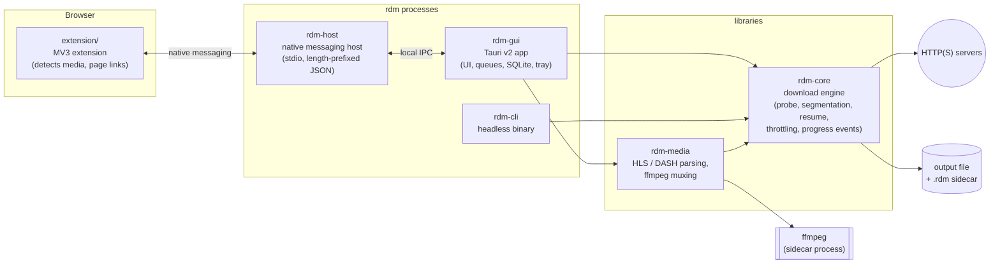

# rdm — Rust Download Manager

A cross-platform (macOS, Windows, Linux) download manager written in Rust,
inspired by Internet Download Manager and
[ab-download-manager](https://github.com/amir1376/ab-download-manager).

> **Status:** Phase 0 (scaffold). The workspace, lints and CI are in place;
> the download engine is not implemented yet. See [Roadmap](#roadmap).

## Architecture



The dependency rule: **`rdm-core` depends on nothing above it.** It has no
GUI, extension or ffmpeg dependencies, and it can be used on its own as a
library. CI enforces this with [`scripts/check-deps.sh`](scripts/check-deps.sh).

| Path | Kind | Responsibility |
|---|---|---|
| `crates/rdm-core` | lib | Probing, dynamic segmentation, positioned writes to one sparse file, resume metadata, retry/backoff, throttling, progress events |
| `crates/rdm-media` | lib | HLS/DASH manifest parsing, segment download, ffmpeg muxing, AES-128 HLS |
| `crates/rdm-cli` | bin `rdm` | Headless front end, used to test the engine without a GUI |
| `crates/rdm-host` | bin `rdm-host` | Native messaging host, plus manifest installer for Chrome, Edge and Firefox |
| `crates/rdm-gui` | bin `rdm-gui` | Tauri v2 desktop app |
| `extension/` | MV3 | Browser extension |
| `tests/` | crate `rdm-tests` | axum mock server and integration tests |

## Building

Prerequisites: a stable Rust toolchain (installed through
[rustup](https://rustup.rs); `rust-toolchain.toml` selects stable with
rustfmt and clippy). TLS uses rustls, so OpenSSL is never required.

```bash
cargo build --workspace
```

```bash
cargo test --workspace
```

These are the same checks CI runs on all three OSes:

```bash
cargo fmt --all --check
```

```bash
cargo clippy --workspace --all-targets --all-features --locked -- -D warnings
```

```bash
./scripts/check-deps.sh
```

Run the CLI:

```bash
cargo run -p rdm-cli -- --help
```

Later phases add more prerequisites:
- **Phase 3 (GUI):** the Tauri v2 system dependencies. On Linux that's
  `libwebkit2gtk-4.1-dev`, `libayatana-appindicator3-dev`, `librsvg2-dev` and
  `patchelf`.
- **Phase 4 (extension):** Node.js, if the extension is written in TypeScript.
- **Phase 5 (media):** ffmpeg on `PATH`. If it's missing, rdm offers to
  download it.

## Project rules

- No `unsafe` code. The workspace sets `unsafe_code = "forbid"`. Positioned
  file writes go through the safe std APIs `std::os::unix::fs::FileExt` and
  `std::os::windows::fs::FileExt`.
- Library code never panics. `unwrap`, `expect`, `panic!`, `todo!` and
  `unimplemented!` are lint errors outside tests.
- Libraries define errors with `thiserror`. Binaries use `anyhow`. Logging
  goes through `tracing`.
- No DRM circumvention. DRM-protected streams (Widevine, PlayReady,
  FairPlay, SAMPLE-AES) are reported as protected content and never
  decrypted.
- Servers are treated politely. A global per-host connection cap and rate
  limit always apply, and any site-mirroring feature respects `robots.txt`.

## Roadmap

| Phase | Scope | Status |
|---|---|---|
| 0 | Workspace, lints, CI, README | ✅ |
| 1 | `rdm-core` engine + `rdm-cli` | ⏳ |
| 2 | Mock server + integration tests | |
| 3 | Tauri GUI, SQLite persistence, tray | |
| 4 | MV3 extension + native messaging host | |
| 5 | HLS/DASH + ffmpeg muxing | |
| 6 | Scheduler, import/export, checksums, AV hook, duplicates, drag-and-drop | |
| 7 | Packaging, signing docs, v0.1.0 release | |

## License

MIT. See [LICENSE](LICENSE).
